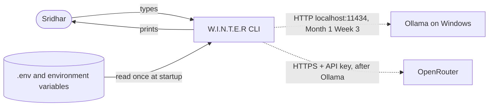

# Context diagram

W.I.N.T.E.R and the things outside it, **as built on 2026-10-26**. Dashed lines are planned, not built.

## Notes

- Only the CLI and the mock provider exist today. No network calls are made yet.
- Ollama runs natively on Windows. The old WSL Ollama also uses port 11434; keep it stopped (see [ADR 0004](../decisions/0004-ollama-first.md)).
