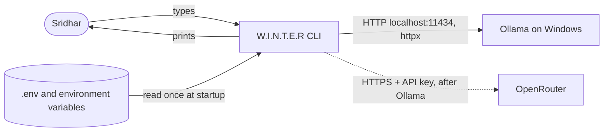

# Context diagram

W.I.N.T.E.R and the things outside it, **as built on 2026-11-19** (after Block 3). Dashed lines are planned, not built.

## Notes

- The CLI, the mock provider and the Ollama adapter exist today. The Ollama adapter makes real HTTP calls to the local server ([ADR 0011](../decisions/0011-httpx-for-http.md)); the mock makes none. OpenRouter is not built yet.
- Ollama runs natively on Windows. The old WSL Ollama also uses port 11434; keep it stopped (see [ADR 0004](../decisions/0004-ollama-first.md)).
