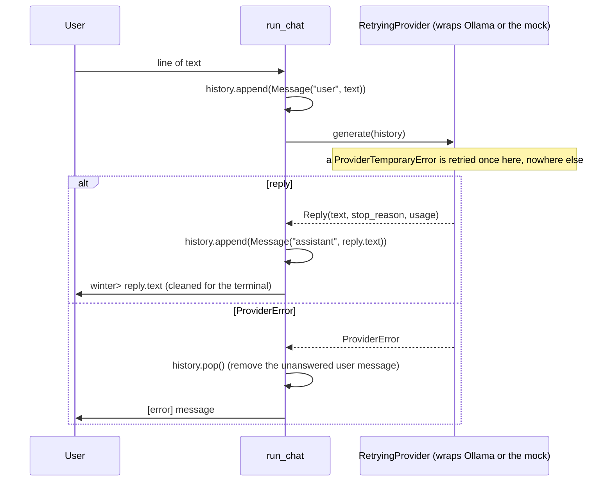

# Request flow

How one chat turn travels through the code, **as built on 2026-11-19** (after Blocks 2b-1 to 2b-4).

## Startup

```text
main()
  ├─ load_settings()      bad value       → print field + reason (never the value) → exit 2
  ├─ build_provider()     ProviderSetupError (e.g. no adapter yet) → "[error] ..." → exit 2
  │                       returns RetryingProvider(inner provider)
  └─ run_chat(provider)                                                            → exit 0
```

Exit 1 is not used by `main()`. Python itself uses it for an uncaught exception (a bug, fail loud).

## One turn



## Notes

- `run_chat` owns the history (a local list). See [ADR 0007](../decisions/0007-cli-structure.md).
- Any exception other than `ProviderError` is not caught and shows a traceback on purpose.
