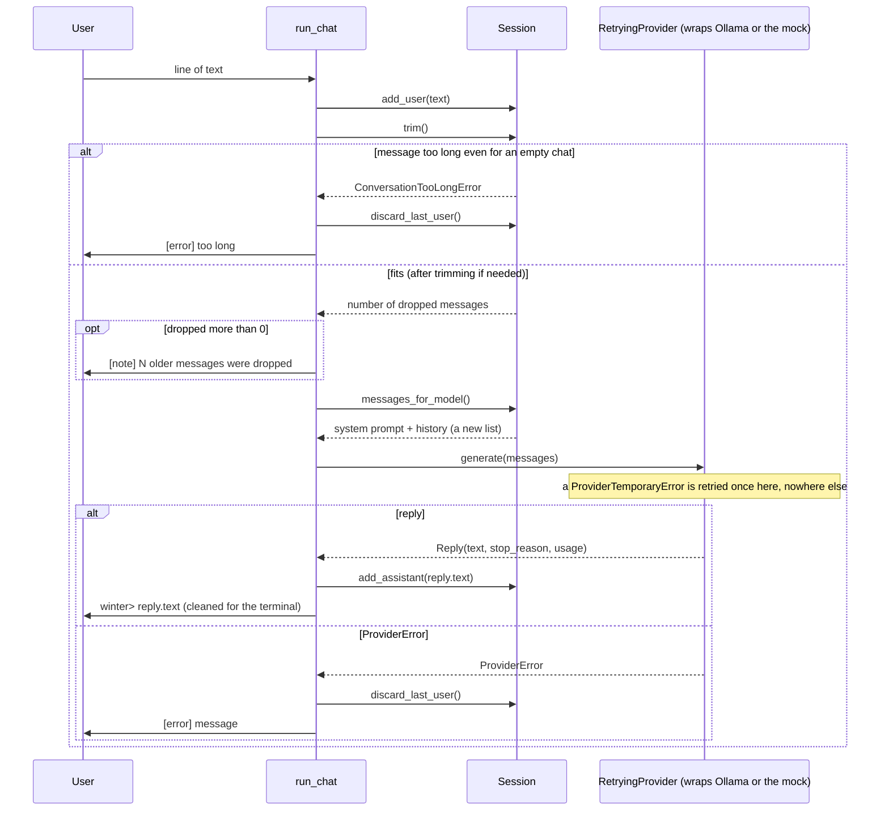

# Request flow

How one chat turn travels through the code, **as built on 2026-11-20** (after Month 2 Week 1).

## Startup

```text
main()
  ├─ load_settings()      bad value       → print field + reason (never the value) → exit 2
  ├─ build_provider()     ProviderSetupError (e.g. no adapter yet, bad URL) → "[error] ..." → exit 2
  │                       returns RetryingProvider(inner provider)
  ├─ Session(load_system_prompt(), budget_tokens=prompt_budget(context_tokens))
  └─ run_chat(provider, session)                                                   → exit 0
```

Exit 1 is not used by `main()`. Python itself uses it for an uncaught exception (a bug, fail loud).

## One turn



## Notes

- The `Session` owns the conversation ([ADR 0012](../decisions/0012-conversation-ownership-and-history-limit.md)): the system prompt and the user/assistant history, always in whole question-and-answer pairs.
- `trim()` keeps, in priority order: the system prompt, the newest message, the first exchange (if it fits), the most recent exchanges. It drops the rest from the middle in whole pairs, down to about 75% of the budget. Trimming is permanent.
- The budget is the context window (`LOCAL_AI_CONTEXT_TOKENS`) minus a 512-token reply reserve. The same window is sent to Ollama as `num_ctx`.
- The system prompt comes from a file; conversation text is never rendered into it.
- Any exception other than `ProviderError` and `ConversationTooLongError` is not caught and shows a traceback on purpose.
