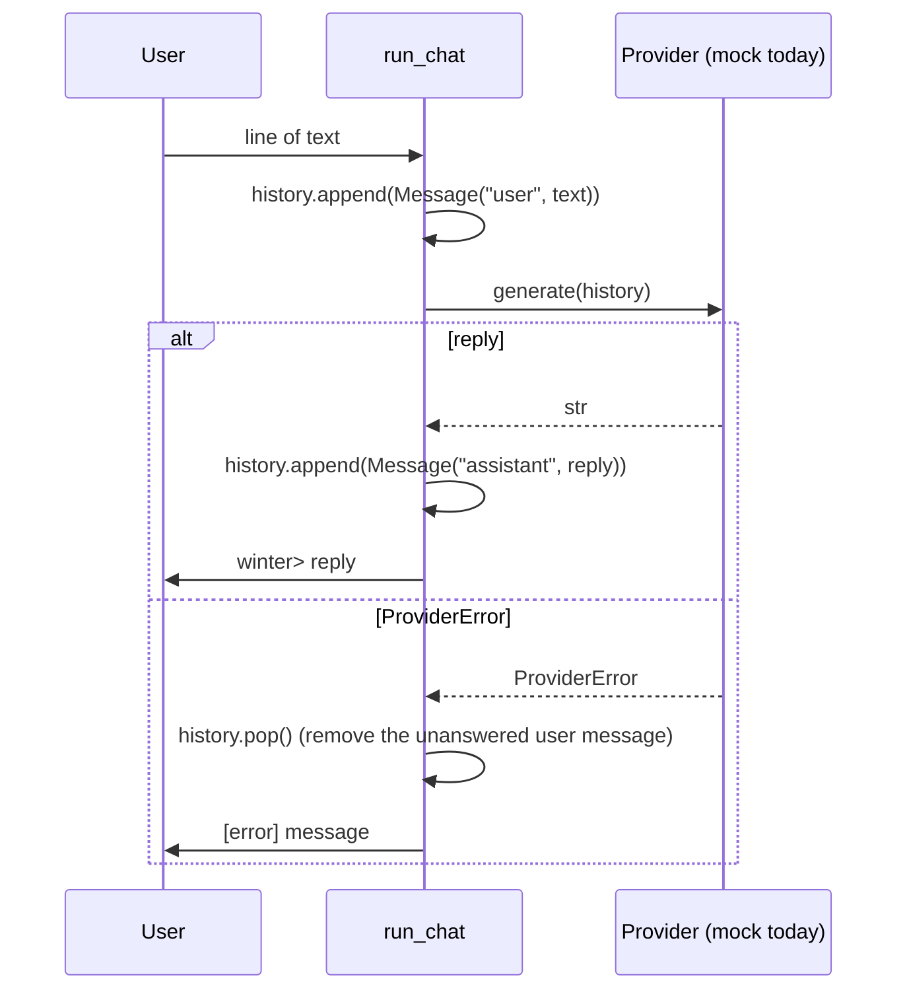

# Request flow

How one chat turn travels through the code, **as built on 2026-10-26**.

## Startup

```text
main()
  ├─ load_settings()      bad value  → print field + reason (never the value) → exit 2
  ├─ build_provider()     no adapter → "[error] ..."                          → exit 1
  └─ run_chat(provider)                                                       → exit 0
```

## One turn



## Notes

- `run_chat` owns the history (a local list). See [ADR 0007](../decisions/0007-cli-structure.md).
- Any exception other than `ProviderError` is not caught and shows a traceback on purpose.
